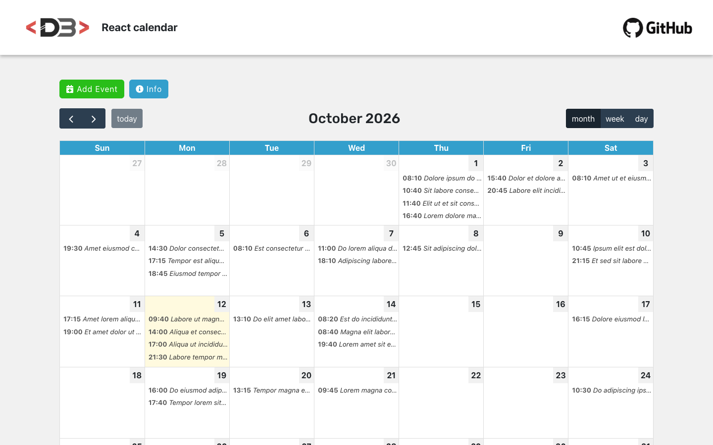

# React Calendar

An event calendar built with React and FullCalendar. Events can be created, edited and deleted from a modal window, and the calendar can be browsed by month, week or day.

**Live demo:** <https://react-calendar.davidebalice.dev/>



## Features

- Month, week and day views
- Add an event with the "Add event" button or by selecting a day on the calendar
- Click an event to edit its date/time and description, or delete it
- Drag and drop events (editable calendar)
- Randomly generated demo events loaded at startup
- Info modal
- Events are kept in memory (no backend): changes are lost on page reload

## Tech stack

- [React 18](https://react.dev/) (Create React App)
- [FullCalendar 6](https://fullcalendar.io/) (daygrid, timegrid and interaction plugins)
- [React Bootstrap](https://react-bootstrap.github.io/) / [Bootstrap 5](https://getbootstrap.com/)
- [Moment.js](https://momentjs.com/)
- [React Icons](https://react-icons.github.io/react-icons/)
- React Context for modal state, CSS Modules

## Getting started

### Requirements

- Node.js 18 or later
- npm

### Installation

```bash
git clone https://github.com/davidebalice/react-calendar.git
cd react-calendar
npm install
```

### Available scripts

| Command         | Description                             |
| --------------- | --------------------------------------- |
| `npm start`     | Start the development server            |
| `npm run build` | Create a production build in `build/`   |
| `npm test`      | Run the tests                           |

## Project structure

```
src/
├── common/       # Header, footer, layout wrapper and context
├── components/   # Calendar, add/edit modal, info modal, demo data
└── index.js      # Application entry point
```

## Author

**Davide Balice** – [davidebalice.dev](https://www.davidebalice.dev)
